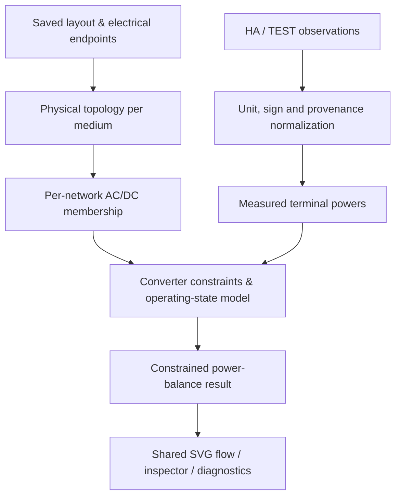

# ADR 07A.2-A — Hybrid inverter / AC–DC energy architecture

**Status:** PROPOSED — architecture-only review; not an implementation or acceptance of the open decisions below.
**Baseline:** `main` at 0.4.35-dev, 2026-11-05.
**Owner:** HA Systems Studio.
**Scope:** device and port semantics, energy conservation, measurement provenance, backup/EPS and compatibility. No HA service calls.

## 1. Verified current contracts and risks

| Existing implementation | Verified behavior | Architectural implication |
| --- | --- | --- |
| `src/energy-topology.js` | Electrical endpoints are `energy_start/end` and `energy_ports` with `medium: ac/dc`; different media never share a bus. | Keep these identifiers and geometry; do not bridge AC/DC by equating bus names. |
| `src/energy-balance.js` | A participant has one role and at most one selected connected network. An inverter's **AC** measurement is selected in preference to DC if AC is attached; if only DC is attached, its existing AC measurement can still be assigned to that DC network. | **Blocking issue before DC activation:** fail closed when a legacy AC-only inverter reading would be used on DC. A single role/reading cannot describe a hybrid. |
| `src/inverter.js` / `src/inverter-readings.js` | The inverter has one AC power field, a legacy polarity toggle and up to 12 PV telemetry input groups. The PV input groups are display/reading data, NOT separate power participants. Default physical ports are only `ac`, `pv1`, `pv2`. | Retain old telemetry and port IDs; explicitly map PV input index → DC port. Never silently add its PV kW to AC production. |
| `src/energy-storage.js` | A storage node has one signed power reading, with a configurable charge-positive convention; its standard port is AC. | An AC-coupled storage node must stay AC. DC-coupled storage requires an explicit physical port and mapping. |
| `src/studio-layout.js` | Normalization retains named electrical ports and fields but explicitly constructs known device schema; unknown nested properties are not guaranteed to persist. | An additive, versioned hybrid schema needs an explicit normalize/save round trip before UI work. |
| `src/energy-flow.js` | Cable kW is inferred only for an unambiguous bridge in a balanced component. | Hybrid conversion must not fabricate branch flow in meshed networks. |
| `energy_buses` | Defined/normalized as metadata but not currently used to connect unlike media in `graph()`. | Do not use this field as an implicit converter or transfer switch. |

The existing AC metering hierarchy and algorithms from 07A.1 remain the baseline. This proposal does **not** change their arithmetic, defaults or existing saved layouts.

## 2. Decision proposal

**A1 — preserve legacy and opt in.** Retain node type `inverter`, its existing `inverter.entities.ac_power`, `inverter.inputs[]`, `energy_ports`, `positive_power` and AC data path unchanged unless `inverter.hybrid.enabled === true`. A separately versioned `inverter.hybrid` object expresses hybrid behavior. Existing nodes without it stay in legacy AC-only mode. No implicit migration.

**A2 — physical networks and conversion are separate models.** An electrical cable only connects ports of the same medium. A multi-terminal inverter has independent external AC and DC terminals and an **internal conversion constraint**. The converter transfers energy *between* networks; it must not merge their electrical bus connectivity.

**A3 — typed terminal bindings, not global inverter roles.** Bind each existing port ID to a function, with strict medium validation. Suggested functions: `pv_dc` (one physical MPPT input), `battery_dc` (bidirectional DC), `grid_ac` (bidirectional), `eps_ac` (separate backup AC), and optionally `aux_ac` if a device explicitly supports it. Port function is independent from user-facing label or drawing direction. IDs are stable, renaming/removal requires validation and preserves legacy identifiers. Map PV1–PV12 by explicit `input_index`, not by label or assumed port count. Unknown/duplicate mappings fail closed.

**A4 — signed terminal convention.** All terminal powers are in **kW at the external network boundary**. `P_port > 0` injects power **into** the connected bus; `P_port < 0` withdraws power **from** that bus; zero is a known zero only when observed or justified by known disconnection. Thus a PV array injects positive DC, an inverter PV input withdraws negative DC, a DC battery injects when discharging and withdraws when charging; a grid-side converter may inject or withdraw AC. The physical observation's vendor-specific polarity is normalized by an explicit adapter, not guessed from node type. Positive legacy `ac_power` remains governed by the old setting for legacy nodes only.

**A5 — conservation, losses, unknowns.** For inverter terminal injections (signed **to the external bus**) the internal energy contract is

`sum(P_terminal_kw) + P_loss_kw = 0`, with `P_loss_kw >= 0` for a physically valid steady operating point.

Example, PV DC supplies 5.0 kW to an inverter (`P_pv_dc=-5.0`), inverter injects 4.8 kW AC (`P_grid_ac=+4.8`), and conversion loss is 0.2 kW. In battery charging from AC: `P_grid_ac=-3.3`, `P_bat_dc=+3.0`, loss 0.3 kW. Loss is **not** silently zero. A fully observed loss may be calculated and labelled derived; if critical inputs or efficiency are unknown the transfer is **partial/unknown**, not rounded into a plausible figure. Future configured efficiencies can be explicit assumptions labelled estimated, never measured. Reject negative implied losses beyond tolerance.

**A6 — canonical telemetry provenance and anti-double-count.** Each physical boundary has one canonical observation identity, e.g. `(device_id, port_id, quantity, measurement_point)`. A vendor MPPT reading and an optional PV-array object depicting the same circuit must not become two sources of production. Explicitly designate the canonical sensor/owner; a second sensor is only a cross-check with mismatch diagnostics. Separate statuses: `measured`, `simulated`, `calculated`, `estimated`, `missing`, `invalid`; unknown is `null`, never zero. Include raw unit, HA entity, timestamp/age if present and polarity normalization. Active power W/kW is not cumulative energy Wh/kWh; SOC alone cannot establish charge/discharge kW.

**A7 — operating state / EPS.** Keep `grid_ac` and `eps_ac` as distinct AC terminals/networks. Proposed states: `grid_connected`, `islanded`, `transition`, `fault`, `unknown`. An explicitly modeled, **observed** ATS/transfer contact may enable or disable an electrical edge; SVG contact proximity and shared names never imply a closed switch. If switch state is unavailable, the affected topology/flow is unresolved rather than presumed energized. EPS operating rules are model- and firmware-specific; not every inverter supports EPS without a battery or the same grid-pass-through behavior. There must be no fictional energization of an isolated feeder.

**A8 — export policy is not a power source.** Retain the existing `export_allowed` AC-only property unmodified. A future hybrid export limit applies to a designated grid boundary and a declared basis (`net_total` vs `sum_of_exporting_phases`). A measured grid export beyond its configured limit is a diagnostic violation, not a calculated hardware command. Potential curtailed PV is **not** measured generation, and unmetered curtailment cannot be invented. Three-phase guarantees and regulatory compliance are out of scope until per-phase data is modeled.

**A9 — read-only by construction.** The card, preview and tests do not actuate inverter, BMS, relays or transfer switches. No automatic wiring, no upstream SVG crossing inference, no HA service calls. Limit this stage to architecture/documentation, with no runtime feature flag enabled.

## 3. Proposed normalized data shape (illustrative only, NOT implemented)

This example shows the **intended boundaries**, not supported current configuration. Do not paste it into an existing HA card. IDs are schematic; the user explicitly creates physical ports.

```json
{
  "type": "inverter",
  "energy_ports": [
    {"id": "ac",  "medium": "ac", "bus": "grid"},
    {"id": "pv1", "medium": "dc", "bus": "mppt1"},
    {"id": "pv2", "medium": "dc", "bus": "mppt2"},
    {"id": "bat", "medium": "dc", "bus": "battery"},
    {"id": "eps", "medium": "ac", "bus": "backup"}
  ],
  "inverter": {
    "hybrid": {
      "schema_version": 1,
      "enabled": true,
      "terminals": [
        {"port_id": "ac", "function": "grid_ac", "reading": {"entity": "sensor.inverter_grid_ac", "sign": "injection_to_bus"}},
        {"port_id": "pv1", "function": "pv_dc", "input_index": 0, "reading": {"entity": "sensor.inverter_pv1_w", "sign": "into_converter_positive"}},
        {"port_id": "pv2", "function": "pv_dc", "input_index": 1, "reading": {"entity": "sensor.inverter_pv2_w", "sign": "into_converter_positive"}},
        {"port_id": "bat", "function": "battery_dc", "reading": {"entity": "sensor.battery_power", "sign": "charging_positive"}},
        {"port_id": "eps", "function": "eps_ac", "reading": {"entity": "sensor.inverter_backup_ac", "sign": "injection_to_bus"}}
      ],
      "operating_state": {"source": "ha", "entity": "sensor.inverter_mode"},
      "loss_model": {"type": "unknown"},
      "export_policy": {"limit_kw": null, "basis": "unknown"}
    }
  }
}
```

The legacy fields outside `hybrid` remain unchanged. Port `bus` links ports **within the same device and medium**; it does not connect PV DC to backup AC. A future validator must reject incompatible terminal-function/medium pairs; changing `count` must not secretly rename a user's ports. The `reading.sign` alternatives are proposed adapter declarations, not current parser options.

## 4. Proposed runtime separation (next stages, not this ADR)



Proposed result additions: `terminals[]` with `device_id,port_id,medium,injection_kw,status,provenance`; `transfers[]` with `converter_id,ac_network_ids,dc_network_ids,loss_kw,status,reason`; separate legacy `networks[]` returned unchanged in non-hybrid mode. The converter is a constraint between networks, not a graph edge that merges electrical conductors. Only a **uniquely solvable** balance can produce a calculated value; mixed underdetermined transfers stay missing. A link animation requires a measured or uniquely inferred signed branch flow, not just the converter's existence.

## 5. Open design decisions to confirm before 07A.2-B

1. **PV representation:** recommend an optional physical `pv_array`/PV-string icon node for visual cabling. The inverter's MPPT terminal remains the primary measurement in a typical HA installation; duplicated PV sensor readings become cross-checks. Alternative: display MPPT ports only and postpone the separate PV node.
2. **Battery coupling:** recommend one `energy_storage` family with explicit, persisted coupling `ac` or `dc`; never auto-convert existing AC nodes. Separate battery DC terminals and BMS telemetry are not equivalent to an inverter-integrated battery feature.
3. **Backup/ATS:** recommend modeling an optional physical transfer switch as its own node, and mode status as a separately observed property. Do not model automatic failover by silently merging `grid_ac` and `eps_ac` buses.
4. **Phase granularity:** begin with aggregate instantaneous active kW for the energy accounting path and preserve room for future L1/L2/L3 readings. Do not claim per-phase export-limit compliance until phase-specific semantics and tests exist.
5. **Legacy DC-only scenario:** recommend fail-closed `inverter_ac_reading_on_dc_network` diagnostic if a legacy inverter with only DC attached would otherwise contribute AC power to the DC solver. Must be resolved as the first compatibility guard before any new DC balance.

**Approval gate:** A1–A9 and the five choices above must be accepted or amended before implementation. This document is deliberately `PROPOSED`, not `ACCEPTED`.

## 6. Acceptance invariants and test matrix for the later implementation

- An existing AC-only inverter + AC storage, PV telemetry rows and previous saved diagrams produce byte-for-byte equivalent normalized legacy fields and equivalent AC numeric results and provenance.
- Adding a DC cable to the old inverter cannot turn its AC power reading into DC generation. Unknown remains missing.
- A mapped PV port with 5.0 kW DC supply and 4.8 kW AC injection reports 0.2 kW loss; a missing observation does not imply 100% efficiency.
- A 3.3 kW AC withdrawal feeding 3.0 kW DC battery charge reports 0.3 kW loss and correct direction.
- Charging and discharging, zero, missing/unavailable, stale, wrong units, impossible loss, ambiguous/duplicate port mappings, conflicting sensors and AC/DC mismatches have explicit fail-closed behavior.
- An islanded EPS with known operating state and battery/PV supply can feed its own critical loads without any invented grid flow. Unknown/transition/fault does not animate as a known energization.
- Export policy reports violations on the **grid boundary** with declared phase semantics; no API actuation and no made-up curtailed production.
- Conversion does not affect the 07A.1 building gross/individual/net hierarchy, legacy save/reload, Undo, hand-routed cables or disconnected networks.
- Maintain deterministic `dist` builds, Node tests, CI and a separate Home Assistant browser acceptance gate before a stable release.

## 7. Reference for variability, not product-specific implementation

SOFAR ESI-5...12K-T1 documentation distinguishes PV, battery, grid and backup ports, and its feed-in-limitation modes distinguish sums of feeding phases from 3-phase aggregate limits. This confirms that manufacturer port/state/export capabilities must be configurable rather than assumed for all hybrid inverters.

- [SOFAR ESI-5...12K-T1 installation/user manual, issue 07, May 2025](https://www1.sofarsolar.com/upload/file/20250616/1750066443223060487.pdf) (sections 4.4, 4.19, 7.4.6).
- [SunSpec Alliance energy storage model specification](https://sunspec.org/wp-content/uploads/2025/01/SunSpec-Alliance-Specification-Energy-Storage-ModelsD4rev0-1.pdf) (background, not a drop-in schema).

**End of 07A.2-A scope:** architecture proposal only. Runtime implementation starts after explicit agreement on open decisions.
